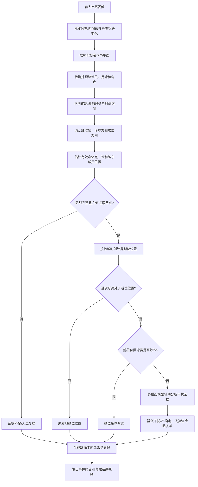

# 固定机位足球越位辅助分析：首版系统设计

版本：V004 · 日期：2026-11-24（北京时间） · 状态：首版工程原型设计与基础实现；尚无项目视频实验。

## 1. 项目目标与输入

用户提交一段从球场宽边一侧拍摄、具有俯视倾角的视频。不同视频的机位位置和角度可以不同。系统计划识别视频中的传球/触球事件，分析触球时刻的越位位置与后续参与进攻情况，并输出以球场平面鸟瞰图为主视角的结果视频。

用户确认的可视化选择：球员以不同身体部位颜色的点表示“朝对方球门方向最靠前的有效身体部位”；越位线与球门线平行。防守队员是否完整可见必须显式检查，守门员可能不在画面内，倒数第二名防守队员也不必然是守门员。

本版首个工程接口接受每个事件的人工/外部模型观察 JSON。仓库没有代表性比赛视频、越位真值或已选择并验证的检测模型，因此本版不能宣称已经自动识别所有传球、准确定位所有身体部位或可靠完成裁判级判罚。

## 2. 端到端流程



规则结论保留四类状态：未发现越位位置、越位位置且触球、疑似干扰/待确认、证据不足。越位位置本身不等于越位犯规；非接球球员是否干扰对手或从越位位置获利应独立判断。

## 3. 各模块路线

| 模块 | 首版路线 | 后续升级与验收重点 |
|---|---|---|
| 视频与分段 | 解码时保留帧号、帧率和时间戳；检测切镜、抖动、变焦和裁切变化 | 变化处重建标定；评估漏分段会造成的几何误差 |
| 球场几何 | 用户可提供图像点与米制球场坐标的对应点；以 RANSAC 单应矩阵映射地面点 | 自动场线/交点检测；用留出点检查像素与米制误差；不同机位或画面段各自标定 |
| 草纹 | 可作为球场方向、分区或场线识别的辅助信号 | 不把明暗草带作为唯一标定基准；光照、磨损和剪草方式会改变其可见性 |
| 球员检测与跟踪 | 先选通用检测器和多目标跟踪基线，再用自有视频验证和微调 | 统计漏检、ID 切换、远侧小目标与拥挤片段表现；模型选择须以数据验证决定 |
| 球队与角色 | 轨迹级球衣颜色分类，人工指定初始球队/攻击方向；角色单独标注 | 验证裁判、守门员、替补及球衣相似情形；禁止把守门员身份当作排序规则 |
| 传球识别 | 球轨迹变化、球员动作、视频时序模型生成触球/传球候选区间 | 先与人工事件标注比较召回、误报及触球时刻误差；不得用普通事件 spotting 精度替代接触时刻精度 |
| 有效身体点 | 输入头、躯干、肩/髋、双脚等候选点，忽略手和手臂，沿攻击方向选择最靠前点 | 关键点中心不等于身体表面边界；单目三维姿态或多机位验证端点和全局坐标误差 |
| 越位规则 | 触球时刻检查进攻方半场、球、所有对手中第二靠近球门者及有效身体部位；平齐按未超过处理 | 球门球、界外球、角球直接接球，以及反弹/对方有意处理等规则情形需专门识别或转人工复核 |
| 画外防守者 | 独立检查防线完整性；不完整且可能改变排序时拒绝自动判定 | 通过更宽视野、第二机位或场景跟踪降低画外风险，不能靠补画固定守门员位置解决 |
| 干扰分析 | 可把触球前后关联帧/短片连同结构化候选信息交给多模态模型，要求列出证据、反证和不确定性 | 概率阈值须通过人工标注验证校准；初期只做筛查/复核建议，不由未验证的 LLM 概率自动定案 |
| 鸟瞰渲染 | 生成球场平面画布，在球场坐标中放球、球员有效点和越位线 | 不将整幅倾斜图像的单应拉伸误称真实鸟瞰；原始片段或证据链接可并列保存 |

## 4. 越位位置与可视化约定

以球场纵向坐标 `y` 指向对方球门，触球时刻为 `t*`。进攻球员须位于对方半场，并且其头、躯干或脚等规则允许部位中最靠前的位置，比球和倒数第二名对手都更接近对方球门线，才处于越位位置；与其平齐不越位。手和手臂不计。对手集合包括守门员，但不依赖守门员必定在镜头内。

鸟瞰帧采用球场坐标到输出画布的映射。越位线在球场平面内是一条与球门线平行的横线；在倾斜原视频里，它可能呈斜线。首版球员点颜色映射：头部红色、躯干/肩髋黄色、脚部绿色；点外圈颜色区分进攻/防守队，外圈样式可标示倒数第二名防守队员及越位候选。图例需要随正式 UI 补全。

单应矩阵只描述球场地面平面。头、肩、躯干和腾空脚的图像点不能直接套用地面单应矩阵得到真实球场坐标。要显示这些身体部位的有效坐标，需经相机投影与三维人体估计，或同步多机位重建；没有可靠估计时必须标不确定。本原型允许事件输入端提供已估计的 `effective_field_point`，并允许为位置附加米制误差，但这些输入尚无项目数据校准。

若防线完整性不足、球或身体端点位置不确定范围跨过判定线、关键球员遮挡/离画，输出需复核或证据不足，不强行输出二元结论。草纹仅作为辅助参照。

## 5. 已实现的原型接口

命令行原型读取：

- 标定 JSON：源图像点、球场米制点、球场尺寸、鸟瞰输出尺寸。
- 事件 JSON：帧号、队伍、攻击方向、防线完整性、球位置、球员身体关键点/已估计有效场地点、接球标志、可选干扰概率。
- 同一个 JSON 可选提供 `tracks` 列表，按视频帧输入球员和足球的跟踪坐标，使鸟瞰结果在非事件帧也显示位置。

随后生成鸟瞰 MP4，并输出事件状态 JSON 摘要。当前检测、跟踪、传球识别和多模态 LLM 都不是内置已验证模块，而是通过稳定的数据接口预留。示例见 `examples/`。

安装和运行：

```powershell
python -m pip install -e .
offside-detect --video input.mp4 --calibration calibration.json --events events.json --output analysis.mp4
```

## 6. 当前限制和下一阶段

本版是可测试的工程骨架，不是自动检测完成版。尚缺真实视频试点、端到端自动事件提取、姿态/球员模型比较、相机标定误差、身体端点误差、LLM 干扰概率校准以及最终精度/速度验收。不得据此宣称“已完成自动越位判罚”。

进入自动模型集成前，应先选定代表性视频并标注一小批传球事件、触球时间、球员球队/角色、有效身体端点、画外风险、球位置及人工判断。使用不同比赛/时段划分开发与保留验证集，避免相邻视频帧泄漏。将保留集用于评估传球检出、关键帧几何误差、越位候选误报/漏报、干扰提示校准和拒判率。
