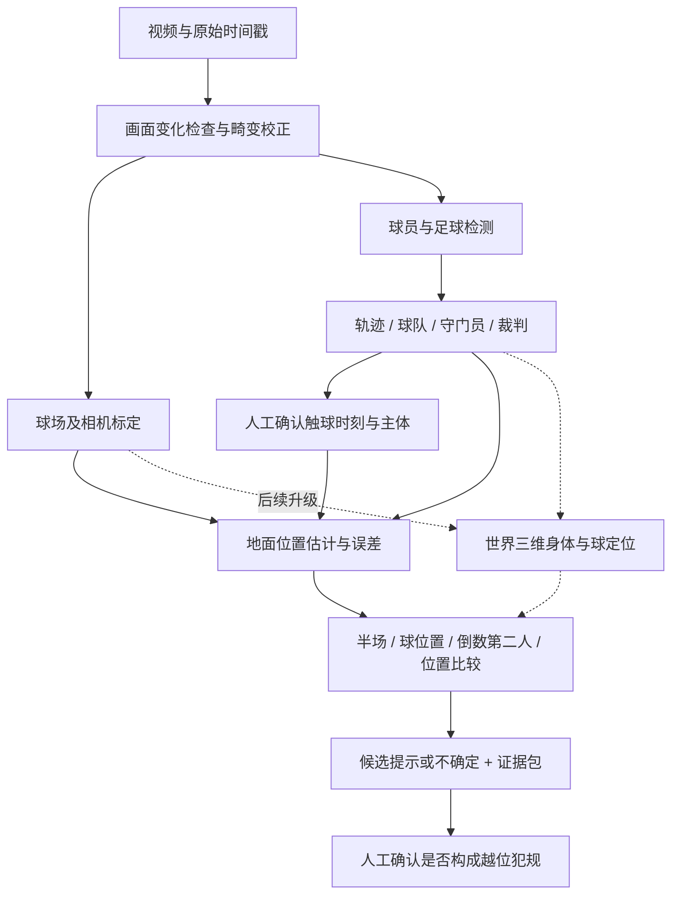

# 固定机位足球视频越位检测：技术分析与现状调研

版本：V002 · 日期：2026-11-13（北京时间） · 状态：技术调研完成，尚未开展视频实验。

用户已确认输入为**固定机位拍摄的球场视频**。机位数量尚未确定，本文以单机位、离线处理为首个原型假设，同时分析多机位升级路线。结论中的“推荐”是项目设计建议，不是已经测得的性能。

## 1. 结论与路线选择

建议首版实现**固定相机标定 → 球员检测与跟踪 → 人工确认队友触球时刻 → 地面位置越位候选提示 → 人工复核**。先验证本项目视频是否足以覆盖防线、区分球员和可靠标定，再增加自动触球检测及三维身体定位。

必须区分三个层级：

| 层级 | 输出 | 需要的证据 | 首版定位 |
|---|---|---|---|
| 地面位置近似 | 球员脚点相对防线的位置及可视化 | 标定、脚点、球队、攻击方向、触球帧 | 可以作为起点；不能代表完整身体越位判定 |
| 越位位置判断 | 头、躯干、脚等合法部位是否越过球与倒数第二名对手 | 同一时刻的世界坐标与误差、完整防线覆盖 | 后续研究目标，边界情况需复核 |
| 越位犯规判断 | 是否应判罚 | 越位位置之外，还需参与进攻、干扰对手、反弹/扑救/对方有意处理球等语义 | 保留裁判/人工确认，不由几何划线直接代替 |

业界半自动越位技术（SAOT）已采用场馆相机跟踪、AI、触球时刻识别和三维可视化辅助 VAR；公开供应商材料能够确认这种系统形态，但不能提供可直接复现的全部算法、训练数据或独立精度证据 [S02]。单机位研究可作为实现参考，不能据此承诺厘米级或裁判级可靠性 [P01, P11, P12]。

## 2. 规则如何转化为计算任务

依据检索时可访问的 IFAB Law 11 当前页面 [S01]。比赛采用哪一赛季、赛事是否有特殊试验，实施前应明确锁定；不能将规则试验当作普遍规则。

### 2.1 必须实现的规则条件

- 处于越位位置本身不是犯规。
- 在队友触球/踢球的规定时刻，进攻球员的头、身体或脚的任何有效部分位于对方半场，并且比**球和倒数第二名对手**都更接近对方球门线，才满足越位位置条件；平齐不越位。
- 手和手臂不计入，包括守门员；手臂上界按腋窝底部定义。仅检测脚踝或骨盆中心不足以完整执行规则。
- 对手排序包括守门员，不能固定为“最后一名后卫”，也不能默认守门员永远最靠近球门。
- 一般采用队友踢/触球的**首次接触**；守门员掷球的情况采用**最后接触/释放时刻**。不能统一用“球离脚的第一帧”。
- 从球门球、界外球、角球直接接球，不构成越位犯规。
- 干扰对手、获得反弹/折射或扑救后的利益、对方有意处理球等，需要规则语义判断。球员暂时在界外等情况也需要专门处理。

### 2.2 位置判定的统一坐标

令攻击方向的纵向坐标为 `q`，从本方球门线的 0 增加到对方球门线的 `L`，所有位置在同一触球时刻 `t*` 计算：

- `A_i`：第 i 名进攻球员全部有效身体部位中最大的 `q`。
- `D_j`：第 j 名对手全部有效身体部位中最大的 `q`。
- `D_(2)`：所有对手 `D_j` 的第二大值，包含守门员，排除裁判。
- `B`：球的纵向位置；精细实现须明确球体边界的几何约定。如果只能估计球心，须保留半径、深度及观测误差，不能把球心结果当作无误差规则基准。

位置条件为：`A_i > L/2` 且 `A_i > max(B, D_(2))`。

这只是位置条件，且假定所有几何量和规则时刻已正确获得。首版若以脚点代替 `A_i`、`D_j`，界面和结果必须写明“地面近似”，不将“脚点未超线”描述成“身体没有越位”。上半场、下半场及加时要显式设置攻击方向。

### 2.3 用不确定性决定是否给出结果

定义纵向余量 `m = A_i - max(B, D_(2))`。结合标定、位置、时间等不确定性给出余量区间：区间完全大于 0 时提供越位位置候选；区间跨越 0 时输出“不确定，需复核”；区间完全不大于 0 时，只能在所用模型及观测范围内说明没有越过基准。

还应联合检查半场条件和防守球员排序。若多个对手的位置区间重叠，倒数第二名的身份可能改变，必须在可行位置组合中重新排序，不能固定某一个人再给窄误差条。防守球员出画、身份不明或身体被遮挡时，应扩大不确定性或停止自动判断。

地面近似还存在未建模的身体前倾与腾空误差，不能只根据脚点模型的小残差排除这些误差。后续误差区间需要数据校准；人为填写的“置信度 95%”没有统计意义。

## 3. 目前采用的技术与可用研究

### 3.1 真实系统：半自动辅助判罚

Genius Sports 于 2026-10-30 发布的 AFA 合作公告描述了场馆相机、运动员位置跟踪、GeniusIQ 实时处理、自动识别出球时刻、VAR 提醒和三维画面，并声称其技术已用于英超等赛事 [S02]。

该公告对阿根廷赛事描述的是**计划**：2026 年 12 月决赛启用以及 2027 年进一步铺开。截至本文日期，不能写成阿根廷已按该计划完成部署。文中的效率改善数字属于供应商陈述，本文不将其作为独立验证的性能结论。

FIFA 官方 SAOT 页面在本次访问中返回 403，因此本文不把常被转述的相机数量、身体点数量、采样频率写成已核验规格。也不能假定各赛事供应商采用相同硬件，或都需要带传感器的足球。实际可借鉴的是：**采集与几何测量、触球时刻、位置比较、人工裁决和证据呈现共同构成系统**。

### 3.2 技术路线比较

| 路线 | 主要方法 | 固定机位适配 | 关键限制 | 建议 |
|---|---|---|---|---|
| 图像划线 | 场线、消失点、图像中的平行线 [P01, P02] | 容易做演示 | 需要正确球场透视和有效身体点；像素横坐标不等于纵向场地坐标 | 仅作解释性基线 |
| 平面位置重建 | 场地标定、单应变换、脚点、跟踪 [P03, P08] | 高，静态几何可复用 | 只适用于地面点，受遮挡和画外球员影响 | 首版主线，明确近似范围 |
| 单目三维重建 | 相机模型、三维姿态/人体网格、时序约束 [P11–P13] | 值得研究 | 深度、全局位置、身体端点和空中运动不确定 | 先独立验证，再接入规则 |
| 多机位三维 | 多相机标定、同步、跨视角关联、三角化 | 可减轻遮挡与深度歧义 | 安装、同步、数据量及维护成本更高 | 需要更高精度时优先评估 |
| 专业 SAOT | 场馆跟踪、触球识别、VAR 与三维呈现 [S02] | 需要专门部署 | 商用内部方法不完全公开，不能直接等价于单机位原型 | 参考系统分工与证据链 |

### 3.3 关键论文的实际启示

**直接越位研究。** 2018 年动态越位线研究使用 Hough、颜色量化、连通分量、消失点和 KLT 等方法 [P02，摘要]，适合作为传统视觉路线背景。2025 年单相机论文采用关键点和消失点划线 [P01，已读结果与后续工作等章节]；其后续工作仍包含球队识别和攻防球员判断，且将守门员参与规则作了不符合完整 Law 11 的简化。它支持“能够做划线演示”，不足以支持“已经完成通用越位判罚”。

**标定。** PnLCalib 联合球场点、线和投影模型优化 [P03，已读方法相关章节]；另一项研究利用线与线、线与圆锥曲线的交点提高球场配准 [P04，摘要]。固定机位可以人工标定起步，以这些方法作为后续自动化候选。BroadTrack 针对转播相机运动的时序建模 [P05，摘要]，是相机跟踪方法，不能误写成球员跟踪器。

**检测、跟踪和全场状态。** ByteTrack 将较低置信度检测也纳入关联 [P06，摘要]；BoT-SORT 结合运动、外观及相机运动补偿 [P07，摘要]。SoccerNet GSR 联合检测、身份、球队/角色和场地位置 [P09]；其当前公开仓库列出 YOLOv11、ReID、TVCalib 和 MMOCR 等组件 [S05]。2025 年改进方案则采用 YOLOv5m、SegFormer 和增强 DeepSORT 等 [P10，摘要]，说明系统表现依赖模块配合和领域适配，不由检测器代际单独决定。

**单目三维的量化边界。** 单幅标定图像的球三维定位研究利用已知球径恢复深度 [P11]。其 Discussion 在无遮挡、高分辨率等有利条件下报告球径预测 MAE 1.6 像素，对应约 1.8 米的投影误差。该数字属于作者的特定任务、数据和指标，**不是所有单机位方案的误差下界**，但说明小球尺寸误差会显著放大深度误差。

**2026 年进展。** Field Converter 从几何初始化出发，用时序残差恢复世界坐标姿态 [P12]；摘要报告根节点误差由几何基线的 49 cm 降至时序模型约 10–11 cm，世界坐标 MPJPE 为 13.2 cm，并指出空中运动仍是主要问题。SMART 摘要给出的局部 MPJPE 0.054 m 与全局 MPJPE 0.324 m 也表明，局部骨架准确不等于球场绝对位置准确 [P13]。这些作者报告的指标均**不是越位准确率，也不是脚尖、肩部等最前端部位误差**，本文未复现实验。

SoccerNet 2026 挑战总结包含 **Spiideo SoccerNet Synloc**：从单张已标定静态相机图像定位球员世界坐标，与本项目更接近；还包括以球员为中心的球动作识别任务 [P14，摘要]。这是后续数据与基线的优先核查线索，尚未核验其下载条件、标签细节和完整评测协议。

## 4. 必需的技术模块

### 4.1 视频输入、时间与可观测性

保留视频原始时间戳（PTS）、分辨率、帧率及丢帧信息。固定安装并不保证几何固定：机械云台转动、光学变焦、数字裁剪、电子防抖、全景拼接都会改变坐标映射。应按有效画面建立标定，发生变化时重新标定或停止输出。

首先检查是否同时看到触球位置、可能接球的进攻球员及完整相关防线。看不见的对手可能改变倒数第二人，不能用“画面里最靠后的两个人”替代完整证据。机位较低、对侧球员太小、逆光、雨夜、球门区拥挤都是潜在失败场景，需要实测。

时间误差可以直接变成位置误差。例如 **30 fps** 相邻帧约隔 **33.3 ms**；若假设两者纵向相对速度 **10 m/s**，一帧差约对应 **0.33 m** 的相对位移。这是算术示例，不是项目测量结果，也不是误差硬上限。插帧只能估计中间状态，不能凭空提供真实接触观测。

### 4.2 相机标定和球场几何

首版建议人工选择分布较广的球场线交点，录入现场实际尺寸。平面单应矩阵有 8 个自由度，至少需要 4 对满足非退化条件的地面对应点；工程上建议选取约 8–12 个可辨识点，并额外留出未参与拟合的检查点 [S06]。

不能默认每个场地都是 105 × 68 m。广角画面先评估镜头畸变；需要时估计内参和畸变再标定。PnLCalib 的简化模型不能自动保证适用于本项目镜头 [P03]。

平面映射可写为 `s [u,v,1]^T = H [X,Y,1]^T`，其前提是这些点位于同一地面平面。**将头、肩、腾空脚或空中足球的像素直接代入地面 H，会得到错误的地面交点。** 要处理这些部位，需相机投影模型和世界三维坐标估计，或多视角信息；仅增加二维姿态模型并不能消除深度歧义。

验证应同时报告留出点的像素重投影误差、球场纵向位置误差和不同区域覆盖情况。总体平均误差不能替代远端、球门区等关键区域误差，也不能替代最终人体端点误差。

### 4.3 球员、球队和角色识别

以 YOLO 系检测器作为候选，对本项目远侧小目标、拥挤区和守门员服装进行验证和必要微调。检索时 Ultralytics 模型页已列出 YOLO26，并将 YOLO11 列为成熟替代 [S07]；首个实验不预设最新型号必然最适合，需固定模型、权重和依赖版本后比较。

可以测试高分辨率推理、分块和局部 ROI，但需要处理重复框与拼接边缘。检测框底边中心只是脚点近似，可能落在阴影、被遮挡下肢或跨步中间；应记录可见性，必要时引入脚部关键点或人工修正。

球队识别可从球衣颜色与轨迹级投票起步，辅以人工初始化；守门员服装不同，裁判也可能接近某队颜色，必须独立标记角色。球衣号码和 ReID 可辅助，但首版不必要求每人姓名识别。

### 4.4 多目标跟踪

以 ByteTrack 做基线；在人群交叉、遮挡恢复等片段比较 BoT-SORT/ReID 的收益 [P06, P07]。同队球衣相似使外观区分困难，运动和场地位置约束仍然必要。固定画面下应评估相机运动补偿是否需要，不能照搬转播配置。

记录轨迹断裂、ID 切换、脚点跳变以及关键触球时刻的倒数第二人识别。丢检后预测位置应标记为预测，不作为无误差观测；画外长时间外推不应代替真实防线覆盖。

### 4.5 足球和触球时刻

足球是小目标，可能被脚、身体或草地颜色遮蔽。应组合球检测、时序轨迹、人体部位关系和动作上下文，输出一段接触候选时间及不确定范围；单纯取“离球最近的人”不能确认触球者，头球等情况也不能只看脚部。

首版由人工逐帧确认触球主体和时刻，保留前后若干帧作为证据。之后再研究球动作 spotting 与触球定位。动作识别事件标签的时间粒度，不应直接等同于规则所需的首次接触精度 [P14]。

当球可能比倒数第二人更接近球门时，球位置会决定越位基准。只有能够在误差范围内确认球不影响基准，才可简化处理；球在空中或被挡住且可能影响结果时，须复核。

### 4.6 身体部位与三维恢复

二维人体关键点有助于识别脚、膝、头和遮挡，但骨架关节并非规则要求的身体表面最前端。脚踝不等于脚尖，肩关节也不等于肩部外缘；分割轮廓还需排除手臂。

升级路线是“已标定相机＋带世界坐标约束的三维姿态/人体模型＋时序一致性”，并独立验证全局位置、合法部位端点和腾空场景 [P12, P13]。模型输出的骨盆相对姿态不能直接用于球场比较。若遮挡或精度要求使单机位不可行，增加同步机位通常比继续强化二维划线更有价值，但仍需标定与跨机位误差验证。

## 5. 推荐系统结构与输出

每次判读建议保留：输入视频标识和哈希、原始 PTS/帧号、标定版本、模型/权重版本、球队和角色、攻击方向、相关轨迹、触球时间区间、采用的身体/地面模型、球与防线位置及误差、叠加画面、人工修正与最终复核意见。

界面分别展示“地面近似候选”“身体位置候选”“证据不足”，并显示所用触球帧。三维动画是证据的呈现形式，不能因动画看起来精细就认为测量具有相同精度。

## 6. 数据、基线与评估

### 6.1 可以利用的数据和开源实现

| 资源 | 能支持什么 | 本项目还缺什么 |
|---|---|---|
| SoccerNet Camera Calibration [S03] | 场线/关键点标定；页面列 20,028 张图像及 2,104 张挑战图像 | 固定机位镜头适配与实际米制误差 |
| SoccerNet-Tracking [P08] | 足球场景框、轨迹与遮挡评估 | 自有视频分布、精确触球和身体端点标注 |
| SoccerNet GSR [P09, S04, S05] | 球队、角色、身份和球场位置的完整管线参考，GS-HOTA | 规则时刻、球与身体三维、越位犯规真值 |
| Spiideo SoccerNet Synloc 2026 [P14] | 单张已标定静态相机的球员世界定位研究线索 | 下载/许可/标签与协议尚待核查 |
| 本项目固定机位视频（待提供/采集） | 领域验证与最终验收 | 需要明确使用授权、采集参数和人工标注流程 |

GSR 论文描述 200 段 30 秒序列；当前任务页公开 train/val/test 数为 57/59/50，属于不同发布范围，应按实际下载版本记录，不混用计数 [P09, S04]。当前仓库提示至少使用数据 v1.3；仓库显示 GPL-3.0 [S05]。采用代码、模型权重及数据前分别核查许可证、使用条款和传播限制，不默认三者相同。

### 6.2 建议的验证协议（尚未执行）

先选择多个独立录像/场次，拟标注约 50–100 次传球或触球事件作为可行性试点；规模是计划，不是已建数据集。标签至少包括触球主体与时间范围、球队与角色、攻击方向、可见性、相关球员位置、球位置以及人工复核意见。无法从单画面建立三维真值的样本，应标记为不确定；研究身体精度需额外测量或同步视角。

按比赛/拍摄时段/场地划分开发集与测试集，避免相邻帧同时落入训练和测试。校准误差和模型选择应在开发集完成，再使用保留样本评估。

| 层面 | 建议指标 | 必须防止的误读 |
|---|---|---|
| 标定 | 留出点重投影误差、纵向米制误差，分区域统计 | 像素误差小不保证身体位置准确 |
| 检测/跟踪 | 目标召回、HOTA/IDF1、ID 切换、关键时刻漏人 | 通用 MOT 指标不能代替越位表现 |
| 角色/排序 | 球队和角色正确率、倒数第二人选择正确率 | 身份错误会改变规则基准 |
| 触球 | 首次/最后接触时间误差（ms）、候选区间覆盖率 | 事件 spotting 命中不等于接触精度达标 |
| 几何 | 脚点纵向误差；升级后测世界位置、有效身体端点误差 | 平均 MPJPE 不能代表最前端部位精度 |
| 系统 | 候选提示 precision/recall、误报/漏报、拒判率和覆盖率 | 大量拒判时不能只报已判样本准确率 |
| 工程 | 硬件、输入大小、端到端处理耗时与延迟 | 单模型 FPS 不能代替整条管线速度 |

重点构造：平齐、只在本方半场、守门员前压、球领先于防线、空中球、头球、身体前倾、多人重叠、画外对手、直接角球/界外球/球门球、反弹与扑救、上下半场换向、变焦/防抖变化等案例。对判读不一致的事件保留争议，不能强制制造二元真值。

验收阈值应在了解视频和测得误差后确定。当前没有证据支持承诺“误差小于 5 cm”“准确率 99%”或“实时裁判级判罚”。

## 7. 分阶段执行建议

| 阶段 | 工作 | 可审阅交付与进入下一阶段的依据 |
|---|---|---|
| A：输入可行性 | 检查代表性视频、完整防线覆盖、机位几何和时间戳；人工标定 | 视频条件清单、标定图、留出点误差；确认该画面能支持地面分析 |
| B：辅助原型 | 检测跟踪、球队角色、手动触球、地面候选、人工修正 | 带证据的事件报告；覆盖典型案例，失败时明确拒判 |
| C：时序自动化 | 足球跟踪与触球候选；完善遮挡、身份和排序不确定性 | 与人工标注比较时间误差、误报漏报及覆盖率 |
| D：身体几何 | 世界三维身体/球或同步多机位；端点误差验证 | 证实误差足以支持目标应用，再扩大自动判断范围 |

下一步最有价值的输入是具有代表性的固定机位录像及其机位数量、位置/高度、分辨率、帧率、是否有变焦/全景拼接、场地尺寸，以及可用计算设备。视频条件和目标用途将决定是否继续单机位，以及需要什么精度与处理速度。本文调研不以这些信息缺失为阻塞。

## 8. 证据边界与配套记录

本版为有边界的技术调研，综合 arXiv 论文、规则官网、官方数据集/代码文档和供应商公告；不是系统综述，不声称穷尽所有论文或商业供应商。论文结果为作者报告，未在本项目复现；部分论文只核验摘要，不能据此评价其未读实验细节。具体来源、版本、阅读范围及失败访问见 [来源与检索记录](02_sources_and_search_log.md)。

使用 ARS-Codex academic-research-suite 辅助研究组织，使用已安装的 arXiv MCP Server 检索论文；工具与技能本身不作为技术结论的证据，实际来源见配套记录。
